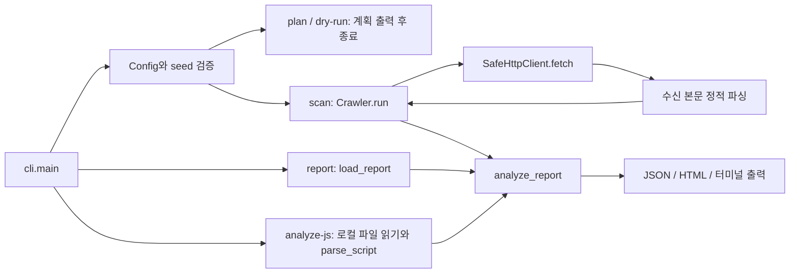

# WebRecon 개발 가이드

마지막 갱신: 2026-11-19. 현재 코드의 읽는 순서, 데이터 계약, 수정 위치와 검증 방법을 설명한다.
사용법은 [README](../README.md), 현재 완료/미완료 상태는 [STATUS](STATUS.md),
설계는 [ARCHITECTURE](ARCHITECTURE.md), 안전 한계는 [SECURITY](SECURITY.md)를 함께 본다.

## 1. 개발을 시작할 때

저장소 루트에서 실행한다. Python 3.10 이상과 표준 라이브러리만 필요하며 pip 설치는 없다.
Windows는 `python` 또는 `py -3`, Linux/WSL2에서 `python`이 없으면 `python3`를 사용한다.
아래 명령은 외부 사이트에 접속하지 않는다. 테스트 중 일부는 명시적인 로컬 루프백 서버를 사용한다.

```text
python -m webrecon --help
python -m webrecon plan --config tests/fixtures/config.loopback.json
python -m unittest discover -s tests -v
```

배포 예시에는 문서용 주소를 사용한다. 개발 테스트에는 tests/fixtures의 설정을 사용한다. 운영 대상 scan을 디버깅 수단으로 실행하지 않는다.
실제 소켓 테스트가 환경 정책 때문에 skip되면 성공으로 기록하지 않는다.

처음 읽을 순서는 [AGENTS](../AGENTS.md) → README → STATUS → 이 문서 → 필요한 코드/테스트다.
소스에는 안전 경계와 판단 이유를 한국어 주석/docstring으로 보완했다. 모든 대입문을 설명하기보다
원래 주소와 저장 주소, 선언과 관찰, 기록과 요청이 갈리는 지점을 먼저 읽는다.

## 2. 실행 흐름



도식은 데이터 흐름이다. 파서를 호출하고 큐를 관리하는 주체는 Crawler다. plan/dry-run은 Config의
순수 검증만 사용하고 네트워크 클라이언트를 생성하지 않는다. report는 Config 없이 로컬 JSON을
읽고 파생 목록을 다시 만든다. 저장된 원본 JS가 없으므로 새로운 구문 해석을 과거 자료에 적용할 수는 없다.
analyze-js는 명시한 로컬 파일을 읽고 새 결과를 만든다. Config/Crawler/SafeHttpClient를 생성하지
않으며 base URL은 상대 주소 조합에만 사용한다. 네트워크 승인 범위로 취급하지 않는다.

scan 내부는 다음 순서다.

1. Config가 target/seed의 형식·origin·개수·설정 상한을 검증한다.
2. Crawler가 승인 플래그를 SafeHttpClient에 전달한다. 승인 없이는 생성 단계에서 거부된다.
3. 모든 시작점을 깊이 0으로 등록하고 페이지 큐를 BFS로 처리한다.
4. fetch가 목적지의 범위·경로·robots·DNS를 검사하고 순차 GET을 수행한다.
5. 페이지의 HTML 구조와 인라인 JS를 분석한다. 발견 자료를 기록하고 허용된 링크만 큐에 넣는다.
6. 페이지 큐가 비거나 예산이 끝나면 참조 JS를 하나 처리한다. 새 페이지가 생기면 문서 탐색으로
   돌아간다. 실제 HTML/JS MIME에 따라 _analyze_response가 파서를 고른다. 이미 받은 robots HTML도 별도 분석한다.
7. 요청 기록과 발견 기록을 합쳐 분류·방문 상태·URL/API/패턴 목록을 만든다.
8. CLI가 JSON을 먼저 저장하고 같은 실행 ID의 HTML을 저장한다.

## 3. 기능별 수정 위치

| 수정하려는 내용 | 먼저 읽을 코드/함수 | 확인할 테스트 |
| --- | --- | --- |
| 옵션·출력 형식 | [cli.py](../webrecon/cli.py): build_parser, main | test_recon.py, test_html_report.py |
| 기본값·상한·seed 파일 | [config.py](../webrecon/config.py): Config, load_config, with_seed_file | test_safety.py, test_seeds.py |
| URL 정규화·승인 origin·주소 | [scope.py](../webrecon/scope.py): normalize_url, validate_url, resolve | test_safety.py |
| GET 방문 제외 경로 | scope.py: path_block_reason, [crawler.py](../webrecon/crawler.py): _discover | test_safety.py, test_seeds.py |
| 간격·요청 예산·마스킹 | [safety.py](../webrecon/safety.py): RequestLimiter, redact_url, safe_headers | test_safety.py |
| 전송·robots·리다이렉트 | [http_client.py](../webrecon/http_client.py): fetch, _follow, _ensure_robots, _one | test_safety.py, test_robots_html_policy.py |
| BFS·페이지/JS 반복 큐 | crawler.py: _discover, _analyze_response, run | test_recon.py, test_javascript.py, test_recursive_content.py |
| HTML 속성·폼·인라인 JS | [parser.py](../webrecon/parser.py): _PageParser, parse_html | test_recon.py, test_response_documents.py |
| JS 구문·const·별칭 | [js_resolver.py](../webrecon/js_resolver.py): Script, Resolution | test_js_resolution.py, test_js_patterns.py |
| JS 후보·추적 기록·예산 | [js_patterns.py](../webrecon/js_patterns.py): parse_script, _finding | test_javascript.py, test_js_patterns.py, test_js_resolution.py |
| JS 누락 진단·이스케이프·괄호 | js_patterns.py: parse_script, js_resolver.py: tokenize, decode_string, Resolution.expression | test_js_diagnostics.py, test_js_extensions.py |
| 명시적 모듈·페이지 이동 참조 | [js_references.py](../webrecon/js_references.py): structural_references | test_recursive_content.py |
| 변수·진단 재집계 | [js_inventory.py](../webrecon/js_inventory.py): build_variables, summarize_diagnostics | test_js_diagnostics.py |
| 로컬 JS 파일 분석 | [local_analysis.py](../webrecon/local_analysis.py): analyze_js_file | test_local_analysis.py |
| API/공격표면 분류·최종 상태 | [analyzer.py](../webrecon/analyzer.py): classify_endpoint, annotate_collection, build_url_list | test_inventory.py, test_diagnostics.py |
| robots 실패 설명 | [diagnostics.py](../webrecon/diagnostics.py), report.py의 REASON_MESSAGES | test_diagnostics.py, test_robots_html_policy.py |
| JSON 저장·재분석·터미널 요약 | [report.py](../webrecon/report.py): save_report, load_report, render_summary | test_recon.py, test_html_report.py |
| 페이지 탐색·참조 트리·콜 그래프 | [report_explorer.py](../webrecon/report_explorer.py), [report_explorer.js](../webrecon/report_explorer.js), js_resolver.Script.named_function_sites, [js_symbols.py](../webrecon/js_symbols.py) | test_js_symbols.py, test_report_explorer.py, 선택적 check_report_explorer.js |
| HTML 표·탭/검색/분할 | [html_report.py](../webrecon/html_report.py), [report_template.html](../webrecon/report_template.html), report_ui.js, report_style.css | test_html_report.py, 선택적 check_report_ui.js |

표의 테스트 파일은 모두 tests/ 아래에 있다. 분류 규칙(analyzer)을 바꾸는 것과 방문 정책(scope/crawler)을
바꾸는 것은 별개다. 예를 들어 API 후보로 분류했다고 그 주소를 요청할 권한이 생기지는 않는다.

## 4. 데이터 계약: 무엇을 저장하고 무엇을 버리는가

| 자료 | 용도 | 주의점 |
| --- | --- | --- |
| models.FetchResult | 한 번의 전송 결과와 일시적 body | 원래 URL·본문이 있으므로 통째로 직렬화하지 않는다 |
| parser.ParsedPage.references | 수집기의 정책 판단에 사용할 URL | 마스킹 전 값이 포함될 수 있다. 저장용이 아니다 |
| parser.ParsedPage.data | 마스킹한 HTML 구조·참조·패턴 | 페이지 결과에 합쳐 저장할 수 있다 |
| parse_script의 references | JS에서 찾은 URL/메서드 단서 | 저장 전에 javascript.public_references를 적용한다 |
| parse_script의 patterns | 마스킹한 주소 형태·이름·위치·미확인 이유 | 원본 식·별도 상수 값 목록은 없다 |
| parse_script의 diagnostics 선택 인자 | 전달한 dict에 호출 집계·제외 이유·위치·한계를 채움 | 반환 3튜플은 유지. 원문 인자 없음, 검출 못한 호출은 집계 불가 |
| js_inventory의 variables/js_summary | 하위 관찰에서 파생한 추적 변수/진단 합계 | 전체 JS 변수 목록 아님. 출처·선언/범위 위치로 구분하고 기록된 단위만 집계 |
| models.ScanResult | 저장 가능한 관찰 자료의 뼈대 | asdict/save_report는 자동 민감값 필터가 아니다. 생산자가 정제해야 한다 |
| analyzer의 url_list/api_list/summary | 관찰에서 파생한 목록/집계 | analyze_report가 dict를 제자리 갱신한다. 원본 파일을 쓰지는 않는다 |

redact_url은 비밀 값과 일부 경로를 지우는 **손실 변환**이다. 반환값을 다음 요청의 원래 URL로 쓰지
않는다. 마스킹 때문에 서로 다른 주소가 합쳐질 수 있다. 새 필드를 결과에 추가할 때는 저장 경로와
HTML 표시 경로를 모두 확인하고 쿼리 값·폼 값·쿠키·본문·원문 예외를 넣지 않는다.

endpoints는 origin+path별로 병합하고 쿼리 이름을 합친다. discoveries는 어디에서 어떤 종류로
발견됐는지, requests는 어떤 요청/차단을 실제로 처리했는지를 보여준다. 응답 수신은 3xx/4xx/5xx도
포함하며 HTML 파싱 성공과 다르다. observed_methods는 응답 근거, declared_methods는 폼/JS 선언이다.

schema_version=1의 옛 자료에는 새 필드가 없을 수 있다. `.get(..., 기본값)` 처리와 구버전 테스트를
유지한다. 특히 analyze_report는 하위 관찰 자료에서 endpoint_patterns를 다시 집계하므로 결과 최상위
목록에만 필드를 붙이면 재분석 때 보존되지 않을 수 있다.
js_diagnostics도 하위 pages/response_documents/scripts에 저장해야 재분석에 남는다. variables는
패턴의 bindings/unresolved_variables에서 생성한다. 옛 자료에 선언 범위가 없으면 참조 위치를
식별 기준으로 사용하며 임의로 전역 변수라고 합치지 않는다. js_summary.available=false는 미기록이다.
로컬 분석은 analysis_mode=local_js, outside_scope=null이며 승인 범위 안으로 표시하면 안 된다.

## 5. 발견한 URL이 자동 방문되는 기준

핵심은 Crawler._discover의 분기 순서다. 먼저 발견 근거를 남긴 뒤 범위·경로·종류·상한으로 결정한다.

| 발견 종류(kind) | 처리 |
| --- | --- |
| target, seed, link, navigation | 범위·경로·깊이·중복·큐 제한을 통과하면 페이지 큐. .js/.mjs는 JS 큐 |
| iframe의 iframe.src | 문서 깊이를 소비하는 페이지 큐 후보 |
| script, script_import | .js/.mjs 또는 확장자 없는 명시적 참조이며 read_scripts=true이면 JS 큐 후보 |
| javascript | JS 호출/문자열의 URL 단서. 완성된 주소도 기록만 함 |
| form, attribute, stylesheet, robots, sitemap, script_response 등 | 기록만 함 |
| record_only=True인 응답 문서 참조 | link/script 형태여도 두 큐에 넣지 않음 |

큐에 들어간 뒤에도 fetch에서 검증한다. robots·리다이렉트는 공통 요청 예산을 쓰고 DNS 실패도 시도
1회로 센다. 페이지 시도 예산에는 실패가 포함된다. page_limit에 도달해도 남은 요청 예산으로 참조 JS를
읽을 수 있지만 전역 limiter.stop_reason이 생기면 이후 요청은 중단한다.

문서 큐는 (url, depth, script_depth), JS 큐는 (url, source, document_url, base_url, depth, script_depth)를
일시적으로 보관한다. 원래 URL은 정책 판단에만 쓰고 결과에는 마스킹한다. 직접 script 참조의
script_depth는 0이며 모듈·추가 JS마다 증가한다. JS가 HTML을 반환하거나 이동 문서를 따라가도
script_depth를 넘겨 체인의 상한을 유지한다. max_script_depth는 설정에서 0~2까지만 허용한다.
page 요청의 JS는 pages 응답 기록과 scripts 분석 자료를 나누고, script 요청의 HTML과 오류 HTML은
response_documents에 남긴다. 오류 응답의 파싱은 record_only여서 후속 요청을 만들지 않는다.

parse_script의 script_url 선택 인자는 모듈 상대 경로를 최종 JS 파일에 맞추기 위한 것이다.
크롤러는 실제 출처 document_url과 HTML base를 반영한 base_url을 구별하며 parse_script의
document_url 인자에는 해석 기준인 base_url을 전달한다. 새 참조 kind를 javascript로 만들면 API 호출
단서와 섞이므로 script_import/navigation을 사용한다. 새 참조도 기존 추출 예산을 공유한다.
모듈/이동 참조는 호출 진단의 fetch/axios/XHR 검출 수에는 포함하지 않는다. 미지원 구문은 누락될 수 있다.

기존 JS 후보가 별도의 실제 페이지 링크에서도 발견되면 그 링크 근거에 대해서는 방문 정책을 판단한다.
후보의 존재만으로 모든 관련 요청이 영구 금지되는 것은 아니다.

## 6. JS 상수 추적을 따라 읽기

1. Script가 주석/문자열을 구분해 토큰화하고 괄호 쌍과 선언 범위를 만든다.
2. 전체 선언을 먼저 등록한다. 나중에 선언된 지역 이름이 바깥 상수를 가리는 경우도 구별하기 위해서다.
3. Script.calls가 fetch/axios/XHR 형태에서 URL 인자 토큰과 메서드 단서를 뽑는다.
4. 호출마다 새 Resolution을 만들고 선행 const·별칭을 선언된 범위에서 추적한다.
5. 결과는 문자열 조각과 Unknown(이름·이유·위치)의 목록이다. 미확인 값을 빈 문자열로 바꾸지 않는다.
6. _finding이 조각을 마스킹된 패턴과 근거로 만든다. 문자열로 완성된 주소만 URL 참조에도 추가한다.
7. parse_script가 각 검출 호출의 해석/제외 결과를 집계한다. 상세 상한 후에도 기록 가능한 단위의
   호출 수는 센다. tokenizer의 problems와 모호 구간은 analysis_issues, 상한은 limit_reasons로 구별한다.

decode_string은 허용된 escape만 수동 해석한다. 단순 괄호 식은 Resolution.expression의 기존 규칙에
재귀적으로 적용한다. 괄호 깊이 32·별칭 깊이 12·이름 해석 128회·조각/문자열 상한을 유지한다.
새 문법을 추가할 때 Python eval이나 JS 실행으로 대체하지 말고 미지원 사례도 함께 테스트한다.

Token.start/end와 Binding.position은 0 기반 **문자 오프셋**, Scope.start/end는 **토큰 배열 인덱스**다.
저장하는 source_location과 선언 위치는 JS 본문 기준 1 기반 행/열이다. 외부 JS의 source는 파일 URL,
document는 최초 발견 문서다. 상대 호출 URL은 base_url 기준으로 해석한다. 인라인 script에는 순번과
HTML script 태그 위치도 붙는다. 바이트/UTF-16 위치로 가정하면 한글이나 이모지에서 어긋날 수 있다.

네트워크 없이 확인하는 Python 예제다. 저장소 루트에서 Python REPL 또는 임시 .py 파일로 실행한다.
내부 함수를 직접 확인하는 예제다. 파일 입력은 아래 analyze-js CLI를 사용할 수 있다.

```python
from webrecon.js_patterns import parse_script

source = '''
const baseUrl = "/api";
const path = baseUrl + "/users";
const url = `${path}/${userId}`;
fetch(url);
'''
references, patterns, limited = parse_script(source, "https://example.invalid/")
item = patterns[0]
print(item["pattern"])                          # /api/users/{userId}
print(item["resolution"])                       # partial
print(item["unresolved_variables"][0]["reason"]) # definition_not_found
print(len(references), limited)                 # 0 False
```

resolved는 정적 조합 완료일 뿐 실제 호출이나 API 존재를 확인한 상태가 아니다. 함수 인자, let/var,
재할당, 민감한 이름, 순환, 미지원 표현식은 추측하지 않는다. 각 파일/인라인 script는 독립적이다.
호출 함수의 실제 정체나 제어 흐름도 실행하지 않으므로 구문 모양에 따른 후보라는 한계가 있다.

직접 미지원 식과 별칭 초기화식은 현재 다음처럼 다르게 남는다.

```python
from webrecon.js_patterns import parse_script

audit = {}
_, direct, _ = parse_script("fetch(makeUrl());", "https://example.invalid/", diagnostics=audit)
_, alias, _ = parse_script("const url=makeUrl();fetch(url);", "https://example.invalid/")
print(direct)                                      # []
print(alias[0]["unresolved_variables"][0]["reason"]) # unsupported_expression
print(audit["excluded_reasons"])                   # {'unsupported_expression': 1}
```

직접 인자의 Unsupported는 parse_script에서 제외되고, 별칭 초기화식의 Unsupported는 Resolution.name이
Unknown으로 보존한다. 두 경로 모두 진단에 결과를 남긴다. _finding도 제외할 때 Unsupported에
고정 이유 코드를 넣는다. limited=False여도 미지원 호출이 없다는 뜻은 아니다.
scripts.parsed=true도 완전성 지표가 아니다. detected_calls는 해석 완료/부분/미확인/제외 수의 합이고
duplicate_calls는 별도 추가가 아닌 부분집합이다. 일반 URL 문자열 후보는 호출 수에 포함하지 않는다.

같은 선언·패턴·이유의 반복 후보는 합쳐질 수 있다. 호출 진단 상세는 상한까지 위치를 보존한다.
모든 호출을 검출하거나 모든 위치를 출력하는 도구는 아니다. HTML은 진단 단위 1개+호출 상세 수가
페이지 진단 예산을 넘지 않도록 한다. 생략은 omitted_call_details/js_diagnostics_omitted로 기록한다.
미확인 base는 origin/domain이 None이며 현재 사이트로 추정하지 않는다. pattern.invalid는 내부 마스킹
처리에만 쓰는 임시 기준 주소로 네트워크에 요청하지 않는다.

새 구문·진단·변수 표시를 함께 확인하는 파일 예제는 다음과 같다.

```text
python -m webrecon analyze-js --input tests/fixtures/assets/analysis-demo.js --base-url https://example.invalid/
python -m webrecon report --input output/webrecon-실행ID.json --list variables
python -m webrecon report --input output/webrecon-실행ID.json --list diagnostics
```

첫 명령은 새 실행 ID의 JSON/HTML 경로를 출력한다. 예제의 기대값은 호출 9개(완료 4, 부분 2,
미확인 1, 제외 2), 반복 1, URL/API 후보 3, 패턴 4, 추적 변수 6, 네트워크 0회다.
같은 userId도 두 함수의 다른 매개변수로 표시한다. 로컬 입력의 출처는 local:input.js이며 파일명을
저장하지 않는다. 테스트 test_local_analysis.py는 DNS/소켓을 차단한 채 CLI·저장·재분석을 검증한다.

## 7. 변경을 검증하는 방법

빠른 확인은 관련 테스트 파일 하나로 시작하고, 작업 완료 전 필수 전체 테스트를 실행한다.

```text
python -m unittest discover -s tests -p test_js_resolution.py -v
python -m unittest discover -s tests -p test_safety.py -v
python -m unittest discover -s tests -v
```

[tests/helpers.py](../tests/helpers.py)의 FakeClock은 실제 대기 없이 완료 후 간격을 검사한다.
simulated_server는 HTTPConnection/HTTPResponse가 메모리 소켓을 사용하게 해 실제 HTTP 포맷 처리를
검증한다. 실제 TCP/TLS/DNS 통합 성공과는 다르다. 테스트의 요청 목록을 검사해 새 후보가 추가 요청을
만들지 않는지도 확인한다. 로컬 테스트 서버의 스레드는 시험용이며 수집기 병렬 요청을 허용하지 않는다.

안전 정책 변경에는 승인 전 DNS 차단, 리다이렉트의 범위/robots 재검증, 오류 후 간격, 요청 예산,
새 필드의 민감정보 제외를 관련 회귀로 확인한다. 순수 보고서 변경에는 입력 JSON 불변, 네트워크 없음,
HTML 이스케이프·CSP, 구버전 필드 누락 처리를 확인한다. 구현을 그대로 되풀이하는 테스트는 추가하지 않는다.

실제 로컬 HTTP는 소켓 사용이 허용되는 환경에서만 아래처럼 재현한다. 두 터미널 모두 저장소 루트다.

```text
python -m http.server 8000 --bind 127.0.0.1 --directory tests/fixtures
```

```text
python -m webrecon scan --config tests/fixtures/config.loopback.json --ack-authorized
```

결과는 output/local-test의 JSON/HTML이다. 테스트 후 서버 터미널에서 Ctrl+C로 종료한다.
일반 fixture는 assets/app.js를 참조한다. const-routes.js는 test_js_resolution.py에서 별도로 사용하므로
위 scan만으로 새 const fixture까지 읽었다고 판단하지 않는다.

## 8. 문제가 생겼을 때 확인 순서

| 현상 | 확인할 결과/코드 | 해석 시 주의점 |
| --- | --- | --- |
| seed만 보이고 페이지 0개 | summary.stop_reason, robots_checks, requests | 입력 URL도 후보에 포함된다. 페이지 응답을 받았는지 먼저 확인 |
| JS가 수집되지 않음 | script src, read_scripts, scripts, script_queue_remaining, issues | 범위·MIME·잘림·robots·예산과 script/javascript 종류 구별 |
| fetch(url)이 안 보임 | js_diagnostics → Script.calls → Resolution.expression/name → _finding | 검출 호출의 제외 이유/위치를 확인. 검출 자체의 누락도 가능하므로 작은 로컬 파일로 재현 |
| script_item_limit 표시 | js_diagnostics의 analysis_issues/limit_reasons | 호환용 통합 신호다. 새 세부 진단으로 토큰 오류·추적/출력 한계를 구별 |
| 같은 변수 이름이 여러 행임 | variables의 source/inline_script/declaration/scope/identity_basis | 파일·함수 범위가 다르면 별도 변수. 옛 자료는 참조 위치 기준으로 보수적으로 구분 |
| POST가 있는데 전송 기록이 없음 | declared_methods와 observed_methods | POST 선언은 관찰 단서이며 전송하지 않는 것이 정상 |
| 차단/중복이 응답 결과와 섞임 | analyzer._request_rank, annotate_collection | 늦은 차단 기록보다 앞선 실제 응답 근거가 우선될 수 있음 |
| HTML을 다시 만들어도 새 후보가 없음 | load_report/analyze_report와 저장된 하위 관찰 | 원본 HTML/JS가 없으면 새 파싱 결과를 복원할 수 없음 |

## 9. 기능을 추가할 때 지킬 경계

- 새 수집기도 SafeHttpClient.fetch만 사용한다. _exchange나 socket을 직접 호출하거나 우회 인자를 노출하지 않는다.
- RequestLimiter.start와 complete의 대응을 유지한다. 완료 시각 기록을 성공 경로로만 옮기지 않는다.
- robots 관찰 목록의 상한이 실제 Disallow 적용을 자르지 않도록 한다. 정책과 발견 목록은 별개다.
- JS 문법 확장은 순수 파서에서 처리하고 실행·함수 호출·자동 API 요청을 추가하지 않는다.
- 새 결과 필드는 저장 직전에 마스킹하고, 재분석에서도 보존되는 원자료 위치를 정한다.
- HTML 표시에는 _text/_address/_escape를 입력 종류에 맞게 사용한다. 마스킹과 HTML 이스케이프는 별개다.
  대상 문자열을 script에 삽입하거나 URL을 이미지/링크 등 활성 리소스로 바꾸지 않는다.
- 보고서 UI를 바꿀 때는 html_report의 data-*와 템플릿 필터를 함께 본다. 고정 UI 스크립트 해시는
  render_html이 매번 계산한다. 표준 라이브러리 실행과 외부 자산 없는 오프라인 동작을 유지한다.
  HTML 구조는 report_template.html, 동작은 report_ui.js와 report_explorer.js, 스타일은 report_style.css에 둔다.
  생성 시 HTML 하나로 합치므로 패키지를 옮길 때 네 자산도 포함한다.
  페이지 분할은 DOM 행을 숨기는 방식이며 검색은 모든 행을 대상으로 한다. 인쇄용 data-matches와
  접근성 aria-controls/aria-selected/tabIndex도 함께 유지한다.

설치 없는 복사 실행은 test_portability.py가 한글·공백 경로와 Python -S(site-packages 제외)로 검증한다.
현재 실행한 OS에서의 결과이며 다른 OS 검증을 대체하지 않는다. UI 회귀는 test_html_report.py와
이미 Node가 있는 개발 환경에서의 `node tests/check_report_ui.js` 및 `node tests/check_report_explorer.js`로 확인할 수 있다.
Node는 선택적 DOM 모의 검증 도구이며 제품/필수 unittest 의존성이 아니다. 테스트를 위해 설치하지 않는다.
실제 브라우저 시각·인쇄 레이아웃 검증은 별도로 기록한다.

새 기능에 외부 라이브러리가 필요해 보이면 자동 설치하지 말고 표준 라이브러리 대안과 한계를 먼저 기록한다.
로컬 웹 서비스는 철회된 상태다. 지원 범위와 남은 한계는 [FUNCTIONAL_SPEC](FUNCTIONAL_SPEC.md)에 있다.

## 10. 작업을 마치고 인계하기

STATUS.md에 바뀐 파일·완료 항목·실행한 명령과 실제 결과·남은 한계·다음 작업을 기록한다.
설계/안전 정책이 바뀌면 ARCHITECTURE/SECURITY/DECISIONS, 사용자 동작이 바뀌면 README/명세도 갱신한다.
예전 시점의 테스트 수를 최신으로 복사하거나 skip·모의 전송을 실제 HTTP 성공으로 표시하지 않는다.
사용자 config/seed/output은 보존하고, 요청 없이 commit/push하지 않는다.

주석만 바꾸는 작업은 실행 로직을 함께 고치지 않는다. 필요한 경우 주석/docstring을 제외한 AST 비교로
변경 범위를 확인하고 기존 회귀 테스트를 실행한다. docstring 자체는 help()/__doc__에서 보이는 설명이므로
텍스트 변화와 실행 로직 변화는 구별한다.

## 공유 JS와 파일 간 호출 수정·검증

문서 문맥과 메모리 예산은 `script_contexts.py`, 이름 지정 import 바인딩은 `js_resolver.py`,
선언·호출 근거는 `js_symbols.py`, 파일 간 연결과 구버전 자료 처리는 `report_explorer.py`를 수정한다.
`tests/test_script_contexts.py`의 두 페이지와 순환 모듈 fixture는 추가 전송 없이 문서별 화면까지 확인한다.

`python -m unittest discover -s tests -v`에서 실제 소켓, TLS, 브라우저 검사 결과도 볼 수 있다.
TLS 검사는 설치된 OpenSSL로 임시 인증서를 만든 뒤 기본 거부·로컬 신뢰·IP 불일치를 검사한다.
브라우저 검사는 기존 Chrome·Chromium·Edge로 임시 HTML을 열어 1280/580px 화면의 배치,
40개 항목 분할, 검색, 모듈 호출과 역방향 이동을 검사한다. 필수 도구가 없으면 해당 검사에 skip 사유가 표시된다.
인쇄물 가독성처럼 육안이 필요한 항목은 실행한 환경과 함께 별도로 기록한다.
